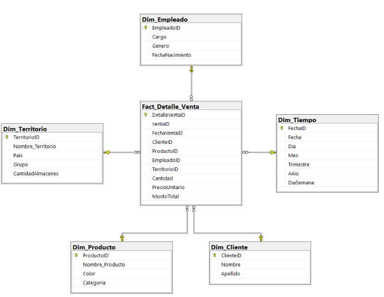
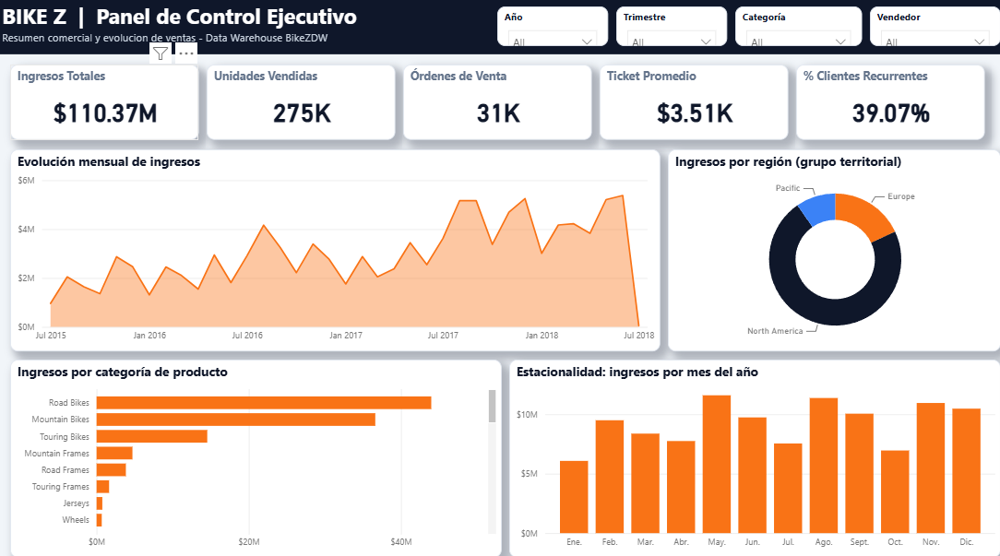
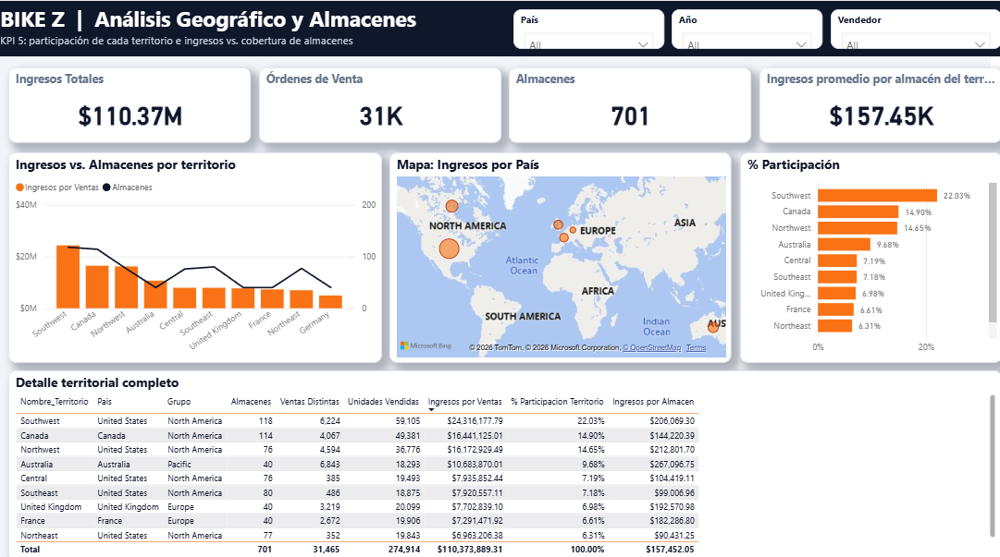
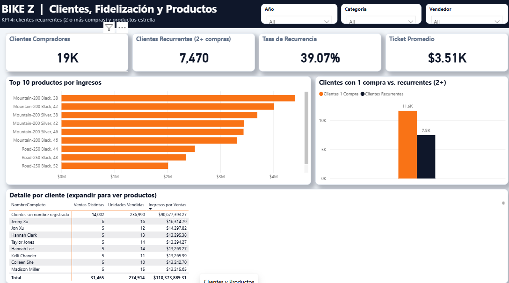

# BikeZ - Inteligencia de Negocios

## Integrantes y paralelo

- Martín Arriagada
- Matías Cayunao
- Tomás Saavedra
- Simón Vargas

**Paralelo:** 300

## 1. Sobre el caso

BikeZ es una empresa que vende artículos para motocross y que ha crecido bastante. Con ese crecimiento, también ha aumentado la información que maneja sobre ventas, productos, clientes y territorios.

La idea de este trabajo es aprovechar esos datos para entender mejor cómo están funcionando las ventas y contar con información que ayude a tomar decisiones. Para eso usamos la base transaccional `BikeZ`, creamos una base dimensional llamada `BikeZDW` en SQL Server y desarrollamos un proceso ETL en Visual Studio con SSIS.

El trabajo está dividido en dos fases. En la primera construimos el modelo dimensional y el proceso ETL, y validamos la información cargada. En la segunda agregamos el proyecto del cubo OLAP en SQL Server Analysis Services (SSAS) y el dashboard de Power BI para consultar los resultados.

## 2. Qué queremos analizar

Principalmente buscamos conocer cuánto vende BikeZ, qué productos tienen más movimiento, cómo se comportan los clientes y cómo se distribuyen las ventas entre los distintos territorios.

A partir de eso definimos cinco indicadores (KPI):

| KPI | Cómo se calcula | Qué nos permite responder |
| --- | --- | --- |
| **Ingresos por ventas** | Suma de `MontoTotal`. | ¿Cuánto se vende por período, producto, categoría o territorio? |
| **Unidades vendidas** | Suma de `Cantidad`. | ¿Qué productos se venden más? |
| **Ticket promedio** | Ingresos totales / número de ventas distintas (`VentaID`). | ¿Cuánto se vende en promedio por compra? |
| **Clientes recurrentes** | Clientes con dos o más ventas distintas / clientes que han comprado × 100. | ¿Qué porcentaje de compradores vuelve a comprar? |
| **Participación de ingresos por territorio** | Ingresos del territorio / ingresos totales × 100. | ¿Qué porcentaje de los ingresos corresponde a cada territorio? |

Es importante distinguir que los ingresos no son ganancias, porque no tenemos información de costos.

También nos interesa comparar las ventas de cada territorio con la cantidad de almacenes que tiene. Esto puede ayudar a revisar la cobertura, aunque no podemos saber cuánto vendió cada almacén, porque la base no relaciona directamente las ventas con un almacén específico.

## 3. Modelo dimensional: cuatro pasos de Kimball

### Paso 1. Proceso de negocio

Escogimos la **venta de productos de motocross**, ya que es el proceso que nos permite responder las principales preguntas comerciales de BikeZ.

### Paso 2. Granularidad

Cada fila de `Fact_Detalle_Venta` representa **una línea de detalle de un producto vendido dentro de una venta**.

Elegimos este nivel porque una venta puede incluir varios productos. Así podemos analizar cada producto, su cantidad y su precio sin perder la relación con la venta completa. En nuestros datos, `DetalleVentaID` identifica cada detalle y `VentaID` permite agrupar los detalles que pertenecen a una misma compra.

### Paso 3. Dimensiones

Usamos cinco dimensiones:

| Dimensión | Información que contiene |
| --- | --- |
| `Dim_Tiempo` | Fecha, día, mes, trimestre, año y día de la semana. |
| `Dim_Cliente` | ID original del cliente, nombre y apellido. |
| `Dim_Producto` | ID original del producto, nombre, color y categoría. |
| `Dim_Empleado` | ID original del empleado, cargo, género y fecha de nacimiento. |
| `Dim_Territorio` | ID original del territorio, nombre, país, grupo y cantidad de almacenes. |

Las dimensiones usan los identificadores originales (`ClienteID`, `ProductoID`, `EmpleadoID` y `TerritorioID`) como claves primarias (PK). En `Dim_Tiempo`, la PK es `FechaID`, que utiliza el formato `AAAAMMDD`.

En el modelo definitivo no usamos columnas adicionales como `ClienteKey`, `ProductoKey`, `EmpleadoKey` o `TerritorioKey`. En `Fact_Detalle_Venta`, la PK es `DetalleVentaID` y las cinco claves foráneas (FK) son:

| FK de `Fact_Detalle_Venta` | PK a la que se relaciona |
| --- | --- |
| `FechaVentaID` | `Dim_Tiempo.FechaID` |
| `ClienteID` | `Dim_Cliente.ClienteID` |
| `ProductoID` | `Dim_Producto.ProductoID` |
| `EmpleadoID` | `Dim_Empleado.EmpleadoID` |
| `TerritorioID` | `Dim_Territorio.TerritorioID` |

La fecha de envío no forma parte de este modelo. `VentaID` se conserva para agrupar detalles de una misma venta, pero no es una FK hacia otra dimensión.



### Paso 4. Tabla de hechos y medidas

La tabla central es `Fact_Detalle_Venta`. Contiene `DetalleVentaID` como clave primaria, `VentaID` para identificar la venta y las claves que la relacionan con las cinco dimensiones, incluida `FechaVentaID` para `Dim_Tiempo`.

Sus medidas son:

- `Cantidad`: unidades vendidas en cada detalle.
- `PrecioUnitario`: precio registrado para ese producto.
- `MontoTotal`: resultado de multiplicar `Cantidad` por `PrecioUnitario`.

Para calcular ingresos usamos `MontoTotal`; sumar los precios unitarios no daría el total vendido.

Escogimos un **modelo estrella** porque la tabla de hechos se conecta directamente con las dimensiones. Por ejemplo, la categoría queda dentro de `Dim_Producto` y el país dentro de `Dim_Territorio`, sin agregar tablas adicionales para consultarlos.

## 4. Datos que tuvimos que revisar

La base original incluye `Ventas`, `DetalleVentas`, `Clientes`, `Productos`, `Categorias`, `Empleados`, `Territorios`, `Paises` y `Almacenes`.

Al revisar los registros encontramos algunos datos incompletos. Tomamos estas decisiones para mantener la información de ventas:

- **Ventas sin vendedor identificado:** agregamos en `Dim_Empleado` un registro llamado «Sin asignar» con `EmpleadoID = -1`. Así esos detalles siguen apareciendo en los resultados.
- **Productos sin categoría:** usamos `LEFT JOIN` y `COALESCE` para mostrar «Sin categoría» cuando corresponde.
- **Clientes sin nombre o apellido y productos sin color:** conservamos los valores `NULL`, en lugar de inventar información.
- **Territorio:** para analizar una venta usamos `Ventas.TerritorioID`, no el territorio del empleado.
- **Almacenes:** contamos los almacenes asociados a cada territorio y guardamos ese dato en `Dim_Territorio`. Es una referencia de la situación registrada en la base, no la cantidad histórica de almacenes al momento de cada venta.

También construimos un calendario con todos los días del período, incluidos los que no tuvieron ventas. En el modelo entregado no implementamos un historial de cambios de las dimensiones (SCD tipo 2).

Al revisar el dashboard encontramos una fila sin nombre de cliente que reunía un monto importante de ventas. Lo comprobamos en SQL Server y vimos que **no se originó en Power BI**: en la base transaccional hay 9.546 clientes sin nombre y apellido registrados; de ellos, **9.341 tienen ventas**. Esos 9.341 clientes representan **14.002 ventas y 90.677.393,27 en ingresos** dentro del DW. En el dashboard se muestran agrupados bajo la etiqueta «Clientes sin nombre registrado», sin excluirlos ni alterar los totales. Esto es una limitación de calidad de los datos de origen que se debe considerar al interpretar los resultados.

## 5. Cómo hicimos el ETL

Trabajamos con **SQL Server 2019, SSMS y Visual Studio con SSIS**. El proyecto está en `etl/proyecto-ssis/BikeZ_ETL/BikeZ_ETL.sln`, y el paquete que ejecutamos es `Carga_BikeZ.dtsx`.

El flujo de control se ejecuta en este orden:

```
Borrar Datos Destino
        |
    Dim_Tiempo
        |
    Dim_Cliente
        |
    Dim_Producto
        |
    Dim_Empleado
        |
    Dim_Territorio
        |
Fact_Detalle_Venta
```

Primero limpiamos los datos previamente cargados en `BikeZDW`, manteniendo el empleado técnico «Sin asignar». Después cargamos las dimensiones y, al final, la tabla de hechos. Ese orden es importante porque la tabla de hechos necesita las claves de las dimensiones.

Utilizamos orígenes y destinos OLE DB. Varias transformaciones se hicieron directamente en las consultas SQL de los orígenes, por ejemplo las uniones de tablas, el tratamiento de nulos, los cálculos y la obtención de los identificadores que relacionan las tablas.

## 6. Comprobación de resultados

Ejecutamos el paquete SSIS y comprobamos la carga en SQL Server. También lo ejecutamos una segunda vez para verificar que no se duplicaran los registros.

Las tablas de `BikeZDW` quedaron con estos datos:

| Tabla | Registros |
| --- | ---: |
| `Dim_Tiempo` | 1.134 |
| `Dim_Cliente` | 19.820 |
| `Dim_Producto` | 504 |
| `Dim_Empleado` | 291 (290 empleados y un registro técnico) |
| `Dim_Territorio` | 10 |
| `Fact_Detalle_Venta` | 121.317 |

Además, comparamos los resultados de la tabla de hechos con la base original:

| Comprobación | Resultado |
| --- | ---: |
| Detalles de venta | 121.317 |
| Detalles únicos | 121.317 |
| Ventas distintas | 31.465 |
| Unidades vendidas | 274.914 |
| Importe total | 110.373.889,3134 |
| Detalles sin vendedor identificado | 60.397 |
| Detalles que no encuentran su registro de origen | 0 |
| Detalles con diferencias en la comparación | 0 |

El importe corresponde a los valores registrados en la base, sin asumir una moneda que no está indicada. Las consultas de comprobación están en `database/scripts/02_Validacion_BikeZDW.sql`, un archivo adicional que dejamos para repetir las pruebas cuando sea necesario.

## 7. Archivos del repositorio

El proyecto está organizado por herramienta y por tipo de archivo. La estructura principal es esta (se muestran los archivos relevantes):

```text
BikeZ-BI/
├── README.md
├── .gitignore
├── database/
│   ├── scripts/
│   │   ├── 01_Creacion_BikeZDW.sql
│   │   └── 02_Validacion_BikeZDW.sql
│   └── backup/
│       ├── BikeZ.bak
│       └── BikeZDW_FINAL.bak
├── docs/
│   ├── modelo-dimensional/
│   │   └── Modelo_Estrella_BikeZDW2.png
│   └── dashboard/
│       ├── resumen-comercial.png
│       ├── analisis-geografico.png
│       └── clientes-productos.png
├── etl/
│   └── proyecto-ssis/
│       └── BikeZ_ETL/
│           ├── BikeZ_ETL.sln
│           ├── BikeZ_ETL.dtproj
│           ├── Carga_BikeZ.dtsx
│           └── Project.params
├── olap/
│   └── proyecto-ssas/
│       └── BikeZ_OLAP/
│           ├── BikeZ_OLAP.sln
│           ├── BikeZ_OLAP.dwproj
│           ├── BikeZ_OLAP.database
│           ├── BikeZDW.ds
│           ├── BikeZDW_DSV.dsv
│           ├── BikeZDW.cube
│           ├── Dim Cliente.dim
│           ├── Dim Empleado.dim
│           ├── Dim Producto.dim
│           ├── Dim Territorio.dim
│           └── Dim Tiempo.dim
└── powerbi/
    └── BikeZ_Dashboard.pbix
```

Las carpetas cumplen estas funciones:

- `database/scripts/`: creación del DW y consultas para validar la carga.
- `database/backup/`: respaldo de la base original y respaldo final del Data Warehouse.
- `docs/modelo-dimensional/`: imagen del modelo estrella y sus relaciones.
- `docs/dashboard/`: capturas de las tres páginas del informe de Power BI.
- `etl/proyecto-ssis/`: solución y paquete de Integration Services para cargar la información.
- `olap/proyecto-ssas/`: proyecto multidimensional de Analysis Services, con su origen de datos, vista de origen, dimensiones y cubo.
- `powerbi/`: informe interactivo desarrollado en Power BI Desktop.

El repositorio también conserva el historial de commits por integrante. Eso permite seguir por separado el trabajo del modelo y ETL, la configuración del OLAP, el procesamiento del cubo, y la creación y correcciones del dashboard.

La presentación final puede agregarse a `docs/presentacion/` cuando el equipo tenga la versión definitiva; no la incluimos en el árbol anterior porque no se verificó que estuviera publicada.

## 8. Cómo revisar o ejecutar el trabajo

Si solo se quiere revisar el resultado, se puede restaurar `database/backup/BikeZDW_FINAL.bak` en SQL Server y consultar las tablas desde SSMS.

Para repetir el proceso completo:

1. Restaurar `database/backup/BikeZ.bak` con el nombre `BikeZ`.
2. Ejecutar `database/scripts/01_Creacion_BikeZDW.sql` para crear la base `BikeZDW` y sus tablas.
3. Abrir `etl/proyecto-ssis/BikeZ_ETL/BikeZ_ETL.sln` en Visual Studio con la extensión de SSIS.
4. Revisar las conexiones OLE DB: `BikeZ` como origen y `BikeZDW` como destino. Puede ser necesario cambiar el servidor o la autenticación si se usa otro computador.
5. Ejecutar `Carga_BikeZ.dtsx`.
6. Ejecutar las consultas de `database/scripts/02_Validacion_BikeZDW.sql` y comparar los resultados.

Hay que tener en cuenta que el paquete **borra los datos previamente cargados en `BikeZDW` antes de volver a cargarlos**. Por eso no se debe ejecutar sobre una base de destino cuyos datos se quieran conservar sin respaldo.

### Revisar el proyecto OLAP

Para abrir el proyecto se necesita Visual Studio 2022 con la extensión **Microsoft Analysis Services Projects**, además de una instancia de **SQL Server Analysis Services en modo multidimensional** si se quiere desplegar, procesar o explorar el cubo.

1. Abrir `olap/proyecto-ssas/BikeZ_OLAP/BikeZ_OLAP.sln`.
2. Revisar el origen de datos (`.ds`) y la vista del origen (`.dsv`), que utilizan las tablas del modelo `BikeZDW`.
3. Revisar las cinco dimensiones (`.dim`) y el cubo (`BikeZDW.cube`). La configuración exacta de atributos, jerarquías y medidas se consulta dentro de esos archivos desde Visual Studio.
4. Configurar el nombre de servidor y los permisos para que la cuenta que procese el cubo pueda leer `BikeZDW`.
5. Si hay una instancia de SSAS disponible, desplegar y procesar el cubo y consultar los resultados. El historial del repositorio incluye el commit «Funciono el procesado del cubo», correspondiente al trabajo de esa etapa.

**Importante:** el archivo `BikeZDW_FINAL.bak` es el respaldo de la base relacional de SQL Server, no un respaldo de un cubo SSAS ya desplegado. Tener el proyecto `.cube` en GitHub permite revisar su definición, pero no sustituye la comprobación de ejecución en Analysis Services.

### Revisar el dashboard de Power BI

1. Abrir `powerbi/BikeZ_Dashboard.pbix` en Power BI Desktop.
2. Revisar las tres páginas: **Resumen Comercial**, **Análisis Geográfico** y **Clientes y Productos**.
3. Probar los filtros de cada página y comprobar que los indicadores cambien de acuerdo con la selección.
4. Comparar los valores sin filtros con la tabla de comprobación de la sección 6 y con las consultas SQL.

El informe que revisamos tiene un modelo de datos importado basado en las tablas de `BikeZDW`. Puede abrirse para analizar esos datos sin conectarse a una instancia SSAS. **No afirmamos que Power BI consulte directamente el cubo OLAP**, porque esa conexión no se ha comprobado. Si se actualiza el origen de datos, es posible que se necesite configurar SQL Server y las credenciales en el computador donde se abra.

##9. Avance por fases y análisis de la segunda etapa

Fase 1 — completada: creamos el modelo estrella en "BikeZDW", ejecutamos el ETL en SSIS y validamos que los detalles de venta coincidieran con los registros de la base original. También conservamos los scripts SQL y el respaldo final del Data Warehouse.

Fase 2 — completada: incorporamos al repositorio el proyecto multidimensional de SQL Server Analysis Services (SSAS) y el dashboard desarrollado en Power BI. Configuramos el origen de datos, la vista del origen de datos, las dimensiones y el cubo OLAP. Posteriormente, el cubo fue desplegado, procesado y consultado correctamente, lo que pudimos comprobar mediante una demostración en Visual Studio.

También desarrollamos el dashboard con los indicadores definidos al comienzo del proyecto, incorporando gráficos, tablas y filtros para facilitar su análisis.

9.1. Cubo OLAP en Analysis Services

El cubo OLAP permite analizar los datos de ventas desde distintas perspectivas, utilizando dimensiones y medidas. Esto facilita la consulta de información sin tener que revisar directamente todas las filas de la base transaccional.

Para construirlo utilizamos como origen el Data Warehouse "BikeZDW", desarrollado en la primera fase.

Los principales componentes son:

- Origen de datos (".ds"): establece la conexión entre SSAS y la base de datos "BikeZDW".
- Vista del origen de datos (".dsv"): incorpora la tabla "Fact_Detalle_Venta" y las cinco dimensiones relacionadas, definiendo la estructura de datos que utilizará el cubo.
- Dimensiones (".dim"): corresponden a Tiempo, Cliente, Producto, Empleado y Territorio. Permiten analizar las ventas según distintas características, como fecha, producto, cliente, vendedor o ubicación geográfica.
- Cubo ("BikeZDW.cube"): contiene la configuración multidimensional y las medidas obtenidas a partir de la tabla de hechos.

El proyecto de Analysis Services se encuentra en "olap/proyecto-ssas/BikeZ_OLAP/", donde están los archivos necesarios para revisar su configuración desde Visual Studio.

Validación y funcionamiento del cubo

Una vez configurado el proyecto, se realizó el despliegue y procesamiento del cubo "BikeZDW" mediante SQL Server Analysis Services.

Durante la demostración en Visual Studio, la implementación finalizó con 0 errores y 0 advertencias, y el procesamiento del cubo terminó correctamente.

Posteriormente, se utilizó el explorador del cubo para consultar sus medidas y comprobar que los resultados coincidieran con la información del Data Warehouse.

Los valores obtenidos fueron:

Medida| Resultado
Ingresos por ventas| 110.373.889,31
Unidades vendidas| 274.914

Ambos resultados coinciden con las consultas de validación realizadas anteriormente en SQL Server.

Esta comprobación permitió verificar que el cubo fue desplegado, procesado y consultado correctamente para las medidas revisadas.

El proyecto también contiene las dimensiones necesarias para el análisis multidimensional. Sus atributos y jerarquías pueden revisarse directamente desde Visual Studio.

Para desplegar, procesar o consultar el cubo en otro computador, es necesario contar con una instancia de SSAS en modo multidimensional y configurar las conexiones y permisos correspondientes.

9.2. Dashboard de Power BI

Desarrollamos un dashboard en Power BI compuesto por tres páginas, con el objetivo de presentar los resultados de manera clara y permitir al usuario analizar los indicadores mediante gráficos y filtros interactivos.

Página| Qué muestra
Resumen Comercial| Ingresos, unidades vendidas, ventas distintas, ticket promedio, recurrencia de clientes, evolución mensual, categorías de productos y estacionalidad.
Análisis Geográfico| Ingresos y porcentaje de participación por territorio, cantidad de almacenes, comparación territorial, mapa por país y tabla de detalle.
Clientes y Productos| Clientes compradores y recurrentes, tasa de recurrencia, productos con mayores ingresos y detalle de compras por cliente.

El dashboard incorpora filtros por año, trimestre, categoría, país y vendedor, según la página. Esto permite comparar los resultados y observar cómo cambian los indicadores dependiendo de la información seleccionada.

Validación de los indicadores

Para comprobar la consistencia del dashboard, comparamos sus indicadores generales, sin filtros, con los resultados obtenidos mediante consultas SQL sobre "BikeZDW".

Indicador| Resultado general
Ingresos por ventas| 110.373.889,31
Unidades vendidas| 274.914
Ventas distintas| 31.465
Ticket promedio| 3.507,83
Clientes compradores| 19.119
Clientes recurrentes| 7.470
Porcentaje de clientes recurrentes| 39,07 %

Los resultados principales coincidieron con los valores obtenidos en el Data Warehouse.

Análisis geográfico y almacenes

En la página de análisis geográfico incorporamos el indicador «Ingresos promedio por almacén del territorio».

Este cálculo divide los ingresos registrados en cada territorio por la cantidad de almacenes asociados a ese territorio.

Su objetivo es entregar una referencia para comparar los territorios, pero no representa las ventas reales de cada almacén, ya que la base original no relaciona directamente las ventas con establecimientos individuales.

Tratamiento de clientes sin nombre

Durante la revisión del dashboard identificamos que una parte de los clientes no tenía nombre ni apellido registrado en la base original.

Realizamos consultas en SQL Server y comprobamos que 9.341 clientes con ventas se encontraban en esta situación, representando 14.002 ventas.

Para evitar que estos registros aparecieran como una fila vacía, se incorporó la etiqueta «Clientes sin nombre registrado».

De esta manera, los datos siguen formando parte de los cálculos y no se pierden ventas ni se alteran los totales del dashboard.

9.3. Qué aporta cada componente a la solución

La solución de Inteligencia de Negocios desarrollada para BikeZ está compuesta por herramientas que cumplen distintas funciones:

- SQL Server: almacena la base transaccional "BikeZ" y el Data Warehouse "BikeZDW".
- SSIS: permite extraer, transformar y cargar los datos desde la base original hacia el modelo dimensional.
- Data Warehouse: organiza la información mediante un modelo estrella, facilitando su análisis.
- SSAS: permite implementar y procesar un cubo OLAP para analizar las medidas desde distintas dimensiones.
- Power BI: presenta los indicadores mediante gráficos, tablas y filtros interactivos para apoyar la toma de decisiones.
- GitHub: permite mantener el proyecto organizado, documentar sus componentes y registrar los aportes realizados por los integrantes.

En nuestro proyecto, el dashboard de Power BI utiliza un modelo de datos basado en "BikeZDW". No se ha establecido como requisito de funcionamiento que consulte directamente el cubo OLAP.

En conjunto, estos componentes permiten transformar los registros transaccionales de BikeZ en información útil para comprender el comportamiento de las ventas, identificar productos relevantes, analizar la recurrencia de clientes y comparar el desempeño comercial de los distintos territorios.

## 10. Dashboard finalizado

Estas son las capturas del dashboard con los indicadores y visualizaciones que desarrollamos.

**Resumen comercial.**


**Análisis geográfico.**


**Clientes y productos.**

